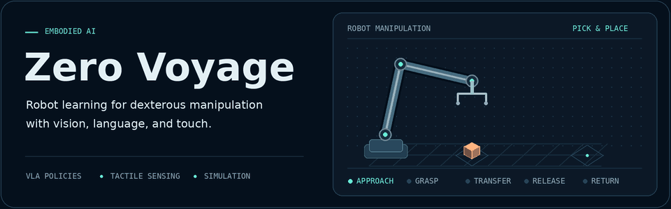

  

I work on **embodied AI for robot manipulation**. My current focus is how fingertip touch can complement vision and language in robot policies, and how to train and evaluate those policies in simulation.

## Featured projects

### [SmolVLA for Tactile Dexterous Manipulation](https://github.com/zero1018/smolvla-tactile-dexterous-mujoco)

A MuJoCo pipeline for multi-finger grasping with an RM65 arm and a Gaia Hand 20. It combines overhead and wrist cameras with fingertip force sensing, and covers episode collection, LeRobot export, SmolVLA fine-tuning, and closed-loop evaluation.

### [NewVLARLDemo](https://github.com/zero1018/NewVLARLDemo)

A StarVLA-based research snapshot for reinforcement learning post-training. It includes the Spectral-RLOO training code, QwenAdapter action-head changes, and LIBERO evaluation records.

---

[Email me](mailto:voygaed.zero@gmail.com)
